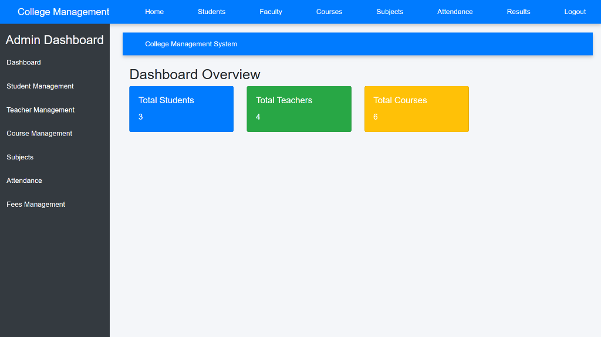
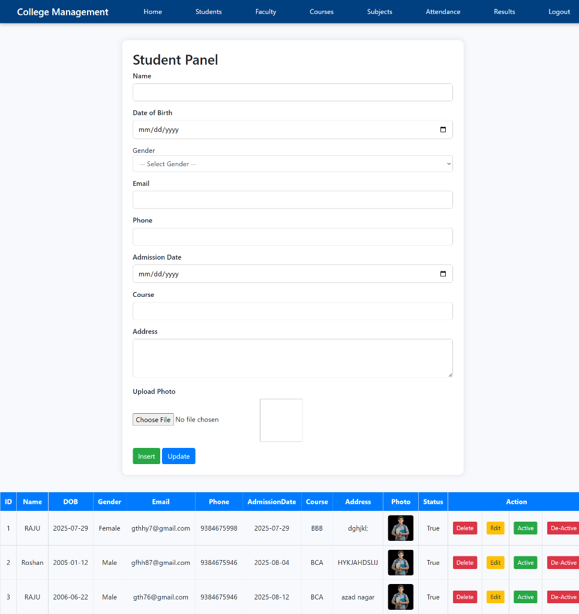
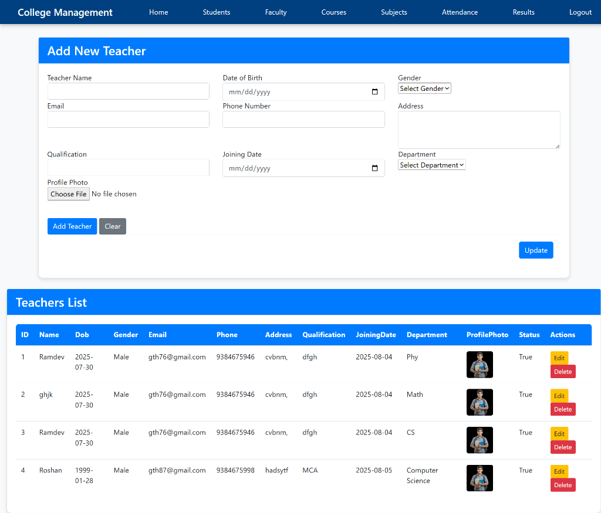
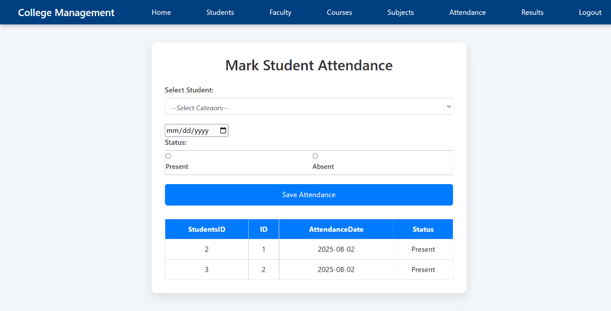
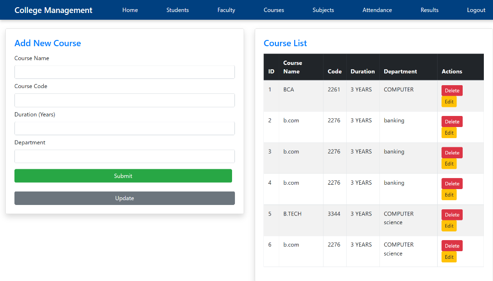
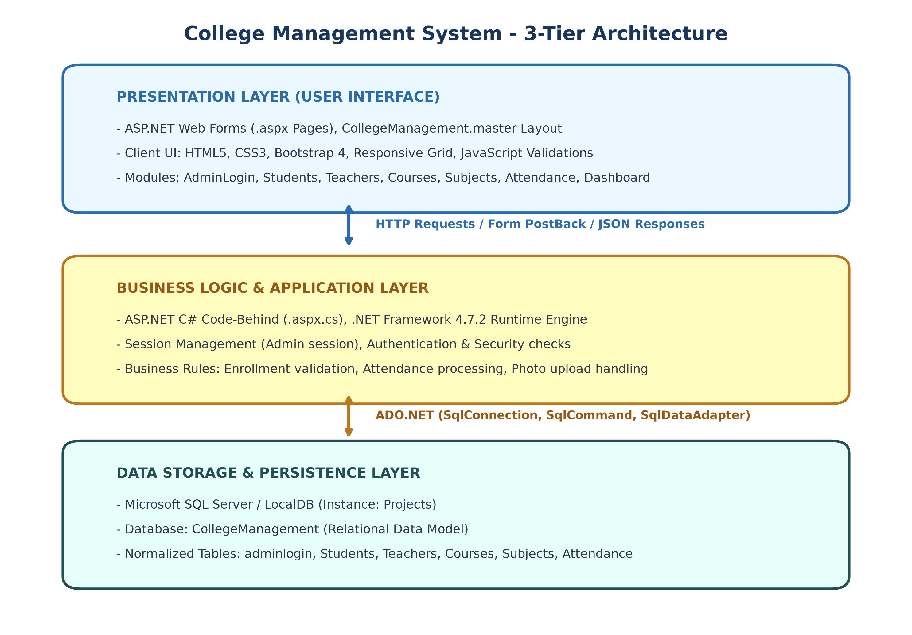
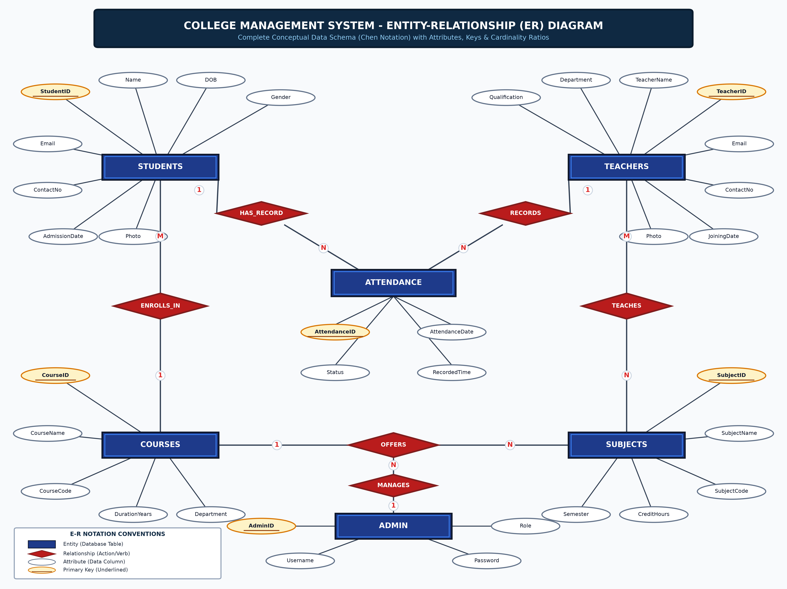

# ?? College Management System (ASP.NET Web Forms)

A comprehensive College & Academic Management Web Application built with **ASP.NET (C#)** and **Microsoft SQL Server**. This system streamlines campus administration including student admissions, faculty records, course & subject allocations, and daily attendance tracking.

---

## 📸 Screenshots & System Diagrams

### Dashboard & Core Screens
| Dashboard | Students Management |
| :---: | :---: |
|  |  |

| Faculty / Teachers | Attendance Tracking | Courses & Subjects |
| :---: | :---: | :---: |
|  |  |  |

### System Architecture & UML Design
| Architecture Diagram | Entity-Relationship (ER) Diagram |
| :---: | :---: |
|  |  |

---

## ? Features

- **?? Authentication & Access Control:**
  - Secure Admin Login (AdminLogin.aspx, Login.aspx) with credential validation and session handling.
- **?? Interactive Dashboard (Dashboard.aspx):**
  - High-level KPIs showing total count of enrolled students, active teachers, departments, courses, and subjects.
- **????? Student Management (Students.aspx):**
  - Full CRUD operations: student admissions, profile photos, contact details, date of birth, gender, and course allocation.
- **????? Faculty / Teacher Management (Teachers.aspx):**
  - Teacher onboarding, qualifications, assigned department, joining date, and profile photo management.
- **?? Course & Subject Administration (Courses.aspx, Subjects.aspx):**
  - Creation and management of degree courses, course codes, duration in years, departments, credit hours, and semesters.
- **?? Daily Attendance Tracking (Attendance.aspx):**
  - Date-wise student attendance recording with status indicators.
- **?? Documentation Included:**
  - Comprehensive Project Report (project_file.docx), Presentation (college_management_system_*.pptx), and full UML diagrams in Screenshots/.

---

## ??? Technology Stack

- **Frontend / UI:** ASP.NET Web Forms, HTML5, CSS3, Bootstrap, Master Pages (CollegeManagement.master)
- **Backend / Logic:** C# (.NET Framework 4.5 / 4.7.2)
- **Database:** Microsoft SQL Server (Transact-SQL)
- **IDE:** Visual Studio 2012 / 2019 / 2022

---

## ??? Database Setup

1. Open **SQL Server Management Studio (SSMS)** or Visual Studio SQL Server Object Explorer.
2. Create a new database named CollegeManagement:
   ``sql
   CREATE DATABASE CollegeManagement;
   GO
   USE CollegeManagement;
   GO
   ``
3. Run the complete setup script provided in this repository:
   - File: **Database_Setup.sql**
4. Check or update the connection string in Web.config:
   ``xml
   <connectionStrings>
     <add name="CollegeManagement" 
          connectionString="Data Source=(localdb)\Projects;Initial Catalog=CollegeManagement;Integrated Security=True;" 
          providerName="System.Data.SqlClient" />
   </connectionStrings>
   ``

---

## ?? How to Run the Project

1. Clone this repository:
   ``bash
   git clone https://github.com/<your-username>/college-management-system.git
   ``
2. Open **College Managemant.sln** in Visual Studio.
3. Verify your SQL connection string in Web.config.
4. Press **F5** or click **IIS Express** to launch the project in your browser.
5. Default Admin Credentials:
   - **Username:** Divyanshu@123
   - **Password:** Ramkrishn991

---

## ?? License
This project is open-source and available under the MIT License.
